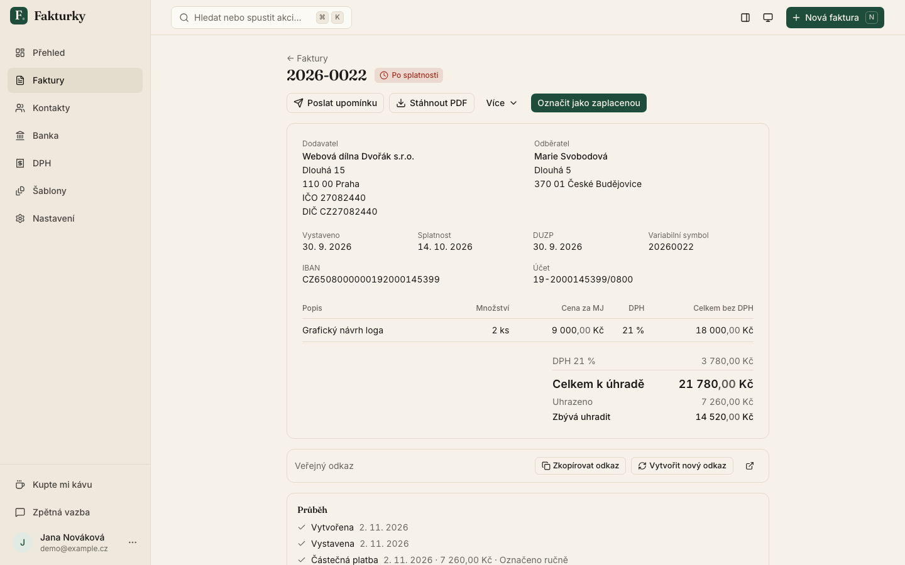
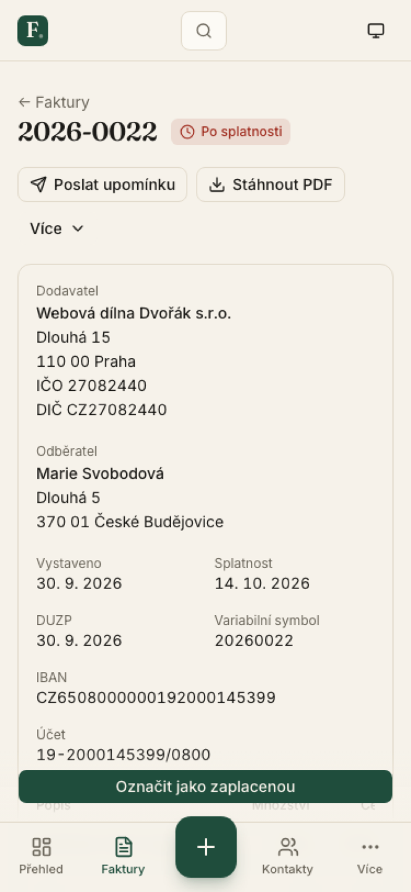
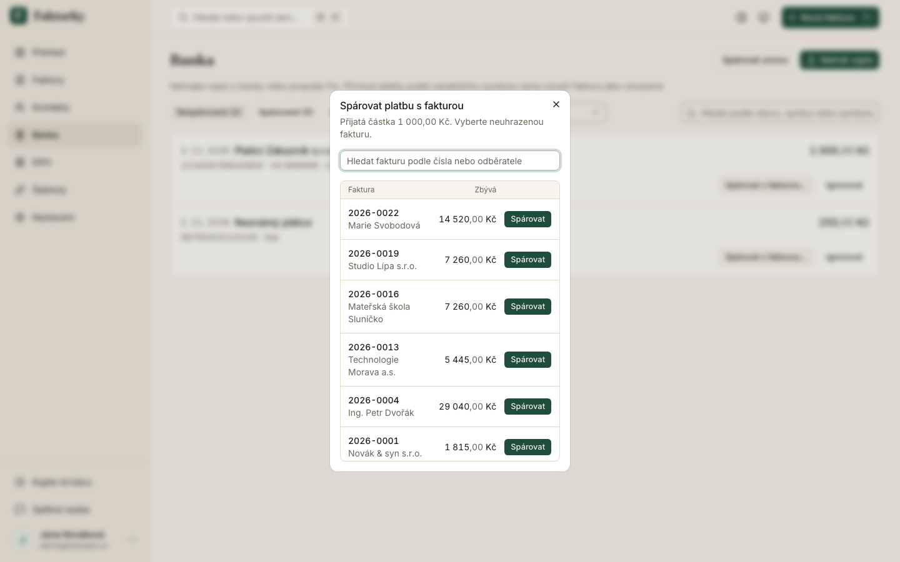
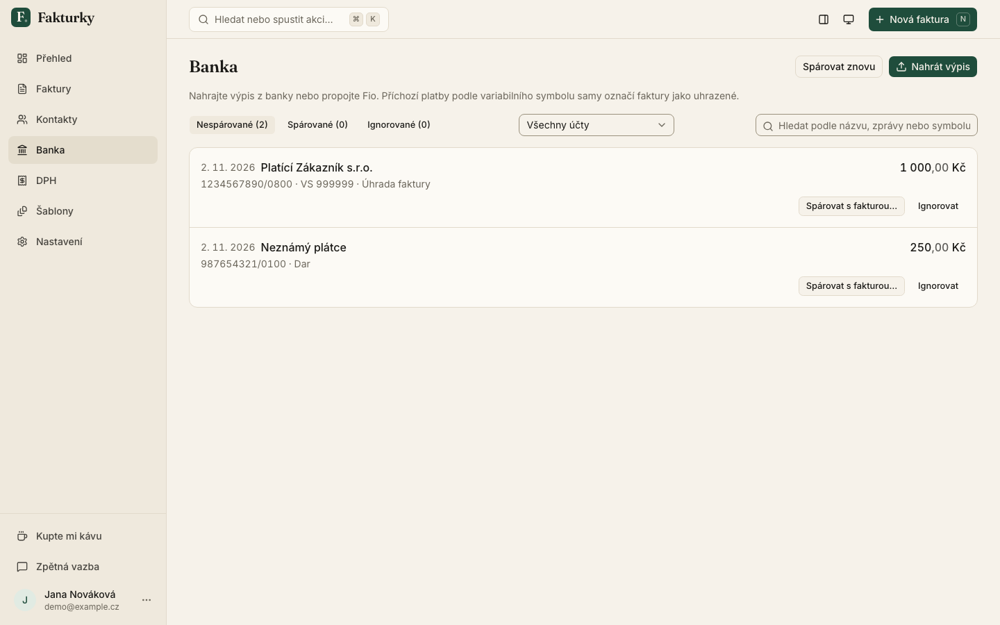
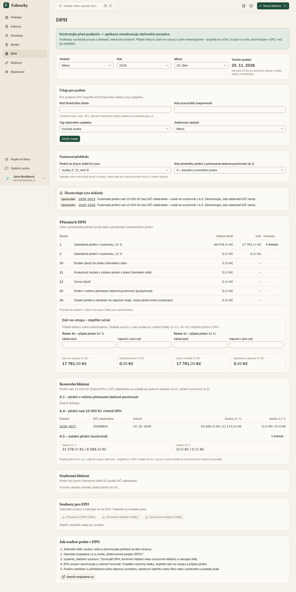
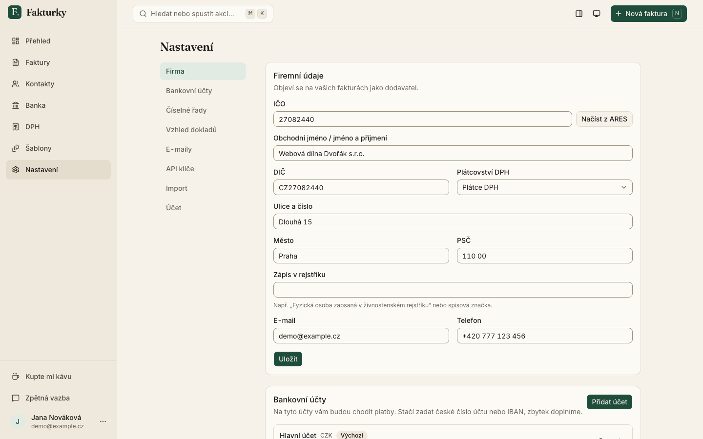

# Morning report

Running log of the overnight build (2026-11-01 → 11-02). Newest at the top of each section.

## Live

- Production: https://fakturky.vercel.app (Vercel Hobby `ladislav-5721`, region fra1, Neon Postgres in Frankfurt)
- Repo: https://github.com/hustyladislav/fakturky (public; Vercel GitHub app installed; Codex auto-review on)

## Needs you

- ⚠️ **Production is behind main.** Vercel Hobby's 100 deploys/24 h quota ran out at ~03:30, so
  https://fakturky.vercel.app still runs the 03:16 build; everything merged after that (TypeScript 7, QA round 2
  fixes, bank import, VAT reports, polish) deploys automatically when the quota frees (~22:00 today). To get it
  live this morning, upgrade the Vercel team to Pro, then run `vercel --prod` once from main (or push any commit).
- **Vercel deploy quota** — we hit Hobby's 100 deployments / 24 h (every PR push built a preview). Production is
  frozen at the 03:16 build (has almost everything) until slots free up ~22:00; later merges (TypeScript 7, QA round
  2 fixes) deploy then automatically. Now only `main` deploys and docs-only commits skip builds. If you want
  previews per PR and no daily cap, upgrade the team to Pro ($20/mo) — your call.
- **Bank statement import + automatic payment pairing (new, free)** — nothing to do for statement upload. For Fio
  sync, `ENCRYPTION_KEY` (32 random bytes, base64) was generated and set in Vercel production + preview (sensitive;
  Fio tokens are stored AES-256-GCM encrypted with it — if you ever rotate it, users just paste their token again).
  Local dev: `openssl rand -base64 32` into `.env.local`. The daily `/api/cron/bank-sync` (04:00 UTC) needs the existing
  `CRON_SECRET`. Migrations 0012–0013 run on the next production deploy of `main` (blocked by the deploy quota above
  until it frees up). Real-bank caveat: the KB / ČSOB / Raiffeisenbank CSV and ABO/GPC readers are built from the
  banks' documented layouts and synthetic fixtures — please upload one real export per bank you use and tell me what breaks.
0. **Preview database** — previews share the production Neon DB (branching option is disabled for this
   marketplace resource on the free plan). Migrations are now gated to production only (`VERCEL_ENV`), and destructive scripts need `ALLOW_DESTRUCTIVE_DB=1`. Proper fix: a Neon
   branch for Preview — see `docs/SECURITY_AUDIT.md`. Also optional: Vercel Firewall rules (paths/limits in that doc).
0b. **Neon branch for Preview (needs a key from you)** — create a Neon API key (Neon console → Account settings →
   API keys; or the Vercel marketplace resource page → "Open in Neon"), then add it as `NEON_API_KEY` (Vercel env,
   Preview + Production, sensitive). With `NEON_PROJECT_ID` (already set) a build step can
   `POST https://console.neon.tech/api/v2/projects/$NEON_PROJECT_ID/branches` (name `preview/$VERCEL_GIT_COMMIT_REF`,
   parent = main branch, with a read-write endpoint), read the branch's connection URI and export it as
   `DATABASE_URL`/`DATABASE_URL_UNPOOLED` for the build and the function (set via `vercel env add … preview <git-branch>`
   per branch, or by having the app read the branch URL at runtime). Until then previews write to the production DB —
   treat previews as production-adjacent and don't create junk data there.
1. **Domain** — pick a name/domain from `docs/research/names.md` (shortlist; `fakturky.app` is free, $9.99) and
   buy it (or tell me to). Then: add it in Resend (your existing account, team "moravio") + DNS → switch
   `EMAIL_FROM` env so magic links/invoice emails reach everyone (today: Resend sandbox, delivers only to you).
   Also add it to Google OAuth origins and publish the Google consent screen (needs homepage + privacy URL).
2. **AI Gateway credits** — the assistant uses DeepSeek V4.1 Flash via Vercel AI Gateway. Caps are set ($100/month
   on the key + $100/month team budget). Hobby includes a small free monthly credit; beyond that, top up credits
   in the Vercel dashboard (AI Gateway → Credits) if you want it running for everyone.
3. **Clerk app** — an unused, empty Clerk app `fakturky-auth` exists on your Vercel team (we went back to Better
   Auth). Say the word and I'll delete it.
4. **Google sign-in** — OAuth client created in Google Cloud project `fakturky`; consent screen is in *Testing*
   (only you can use it) until it's published with the domain + privacy page.

5. **Publish the CLI to npm (needs a token from you)** — `packages/cli` (`fakturky` binary) is publish-ready and the
   workflow `.github/workflows/publish-cli.yml` publishes with provenance when a `cli-v<version>` tag is pushed. I
   did **not** publish. To release: create an npm token (npmjs.com → Access Tokens → *Granular*, publish rights for
   package `fakturky` — the name was free at last check — or an Automation token), add it as the GitHub repository
   secret `NPM_TOKEN`, then `git tag cli-v0.1.0 && git push origin cli-v0.1.0`. Until then the `npx fakturky …`
   examples in the README, `/llms.txt` and `/docs/mcp` do not work.

## Try it

- App: https://fakturky.vercel.app (Google sign-in works for you; email+password for anyone)
- AI assistant: ⌘J inside the app
- MCP: `https://fakturky.vercel.app/mcp` — connect Claude/ChatGPT/Cursor per https://fakturky.vercel.app/docs/mcp
  (OAuth sign-in or an API key from Nastavení → API klíče)
- REST: https://fakturky.vercel.app/docs/api · CLI: `packages/cli` (until published) · https://fakturky.vercel.app/llms.txt
- Import your Fakturoid history: Nastavení → Import

## Screenshots (current `main`, local seed data)

| Invoice detail | Invoice on phone | Bank pairing |
|---|---|---|
|  |  |  |
| **Banka** | **DPH** | **Nastavení** |
|  |  |  |

## Shipped overnight

- Final polish #132–#137: styled Czech selects/file pickers, one primary action per invoice status + "Více" menu,
  Nastavení with sub-navigation and deep links, bank dialogs (currency select, Fio token steps), aligned pairing
  dialog, error/loading states with "Zkusit znovu", mobile access to Banka/DPH/Šablony.
- **VAT reports for payers** (/dph) #123/#125/#126/#127/#129: přiznání k DPH (DPHDP3), kontrolní hlášení (DPHKH1),
  souhrnné hlášení (DPHSHV) XML validated against the official XSDs, drill-down, warnings, manual input-VAT rows,
  EPO upload guide + disclaimer. Also via REST/MCP/CLI. Input side (received invoices) stays manual for now.
  Open questions for you (goods vs services per line, KH A.1 code per line, rounding) in `docs/research/vat-reports.md`.
- **Bank import + automatic payment pairing** (/banka) #122/#124/#128/#130/#131: Fio/Revolut/Raiffeisen/ČSOB/KB
  CSV (+ manual column mapping), ABO/GPC, CAMT.053; Fio API daily sync (token AES-encrypted, `ENCRYPTION_KEY` set);
  exact VS+amount auto-match, fuzzy suggestions, partial/overpayments, undo. **Please test with a real Raiffeisen
  CSV export** (parsers were built from docs + synthetic fixtures). Goes live with the next production deploy.
- **QA round 2** (issues #103–#114) fixed: invoices to consumers without IČO/DIČ #105, proforma VAT preview + PDF
  label #107, payment/date validation #111, contact country + VIES + EU reverse-charge check #116, credit-note
  PDF/balance #117, split-rate receipts #118, unique variable symbols + CLI `pdf -o` #119, related-document links +
  real dialogs instead of `window.prompt` #120; e2e for credit note / related docs / cron #121.
- TypeScript 7 (native compiler) across the monorepo #104 — no code changes needed; 307 unit + 15 e2e tests green.
- PWA (installable on phone) #100; performance pass with lazy-loaded heavy UI #93; a11y checks (axe) in e2e #101/#102.
- **Late night batch**: proforma → tax receipt for received advance → final invoice #94/#96; ČNB rate follows DUZP,
  CZK VAT amounts, rounding line #92/#98; document appearance (accent colour, logo, signature) #95; JSON export +
  e2e #97; VAT treatments per line instead of "0 %" #89/#91; legal QA fixes (registry note, required customer data
  for tax invoices, payment block on public page, 2 536 500 Kč warning) #82; number series settings #81;
  Fakturoid/CSV/ISDOC import #77; design QA passes #83/#85/#87/#90; e2e now a required check.
- **In-app assistant (⌘J)** #38/#68/#74: DeepSeek V4.1 Flash via AI Gateway (US inference, prompt training
  disallowed), every app action as a tool, approval cards for destructive actions, navigation tools, ⌘K "Zeptat se
  asistenta". Hard caps: $100/month global, $2/month per organization, per-user rate limit + gateway key/team
  budgets. Measured ≈ $0.01 per typical conversation. Note: zero-data-retention requires a paid Vercel plan
  (opt-in via `AI_ZERO_DATA_RETENTION=1`).
- **QA**: Playwright e2e of the full MVP journey (payer + non-payer) in CI #43; bug bash → issues #52–#66, fixes
  #34 #45 #67 #79 #80 (e.g. Czech-formatted amounts, DUZP default, mobile actions, Prague-time dates).
- Security audit done (`docs/SECURITY_AUDIT.md`): tenant-isolation suite over every procedure, CSRF/origin checks,
  CodeQL + gitleaks + OSV + dependency review in CI, `SECURITY.md`, Dependabot alerts on. Set `CRON_SECRET`
  (prod+preview) so recurring invoices/reminders run; branch protection on `main` (required `check` + `gitleaks`).
- Agent surfaces: API keys + `/docs/api` #17, remote MCP server `/mcp` (OAuth 2.1 + CIMD, API keys) #35,
  `fakturky` CLI #39, `/llms.txt` #40. Landing page + dashboard at `/prehled` #41.
- Invoice e-mail sending #44, overdue reminders + CSV export #48, security: nonce CSP/HSTS #42, auth hardening #50,
  lookup proxy rate limits + revocable public links #51.
- Fixed: production was being deployed from session worktrees via CLI (stale branches); Vercel Git integration now
  connected — production deploys only from `main`.
- Invoices end-to-end: documents core (drafts, issue with atomic numbering, payments, cancel) #20, invoice UI
  (list, form, detail) #25, PDF rendering #26, public invoice page `/f/:token` + ISDOC #29, dashboard #28.
- Onboarding with ARES autofill #19; Google sign-in + magic link (Resend sandbox) #23/#24; DB joins #27.
- App shell with ⌘K + shortcuts #22; logo, favicon, OG image #21; router → agent-tools adapter #18.
- Better Auth dashboard connected (dash.better-auth.com → project "Fakturky", free Starter plan): users, orgs,
  events, security insights (PR #14).

- Domain package: VAT totals, numbering, IČO/DIČ, Czech account → IBAN, bank codes, SPAYD + EPC QR, ARES, ČNB
  rates, VIES, ISDOC 6.0.2 (PRs #1, #3–#7).
- Monorepo foundation: TanStack Start, Tailwind v4 + shadcn, Drizzle + Neon, Better Auth, oRPC + REST/OpenAPI,
  contacts, CI (PR #2).

## In progress

- `invoices` — PDF download (#31), then templates, recurring, proformas, credit notes, email sending, CSV export
- `agents` — API keys (#17), MCP server, CLI, llms.txt
- `shell` — auth restyle + terms/privacy (#30), landing page, mobile/responsive pass
- assistant agent — in-app AI assistant (⌘J) with spend caps
- security agent — tenant-isolation tests, headers, CI security scanners, `docs/SECURITY_AUDIT.md`
- qa agent — Playwright e2e of the MVP journey, bug bash → GitHub issues

## Decisions made

- Design: council picked direction A (calm editorial) + B's shell + C's mobile flow → `docs/DESIGN.md`.
- Name: "Fakturky" kept as working name (council split; hotovo.* domains taken). Rename = one constant.
- Auth: Better Auth (Clerk tried, reverted on your request).
- Assistant model: DeepSeek V4.1 Flash (newer than V4), US-hosted, zero data retention; no EU host exists for it.
